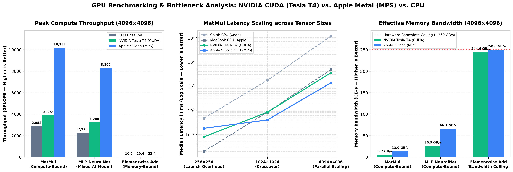
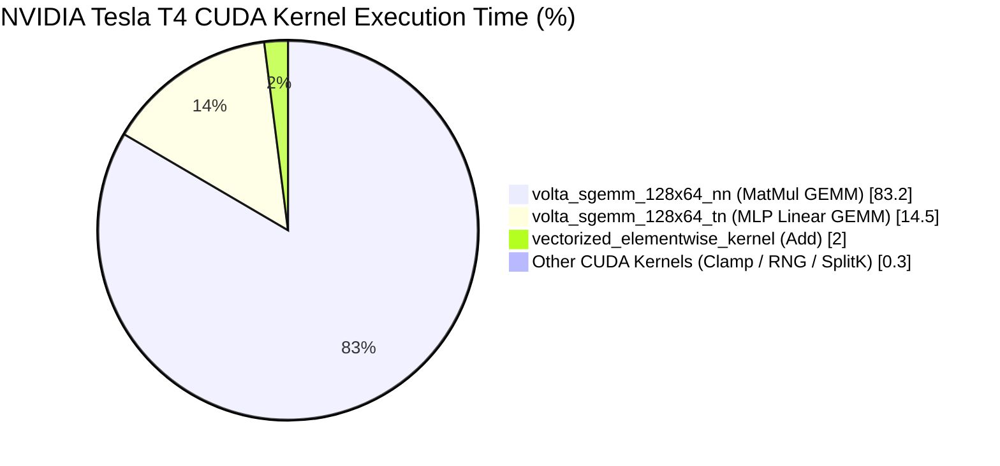

# GPU Benchmarking & Performance Analysis Toolkit

A cross-platform GPU benchmarking, Roofline bottleneck analysis, and kernel profiling toolkit built with **Python**, **PyTorch**, **CUDA**, **Apple Metal (MPS)**, **NVIDIA Nsight Systems (`nsys`)**, and **PyTorch Profiler**.

## Key Features
- **Repeatable Hardware Benchmarks:** Warm-up iterations, hardware `torch.cuda.Event` timers, explicit synchronization barriers, and statistical summaries (`Median`, `Mean`, `P95`, `StdDev`).
- **Cross-Architecture Comparison:** Evaluates `MatMul`, `Elementwise_Add`, and `MLP_NeuralNet` across **NVIDIA Tesla T4 (`CUDA`)**, **Apple Silicon (`MPS`)**, and **CPU** backends.
- **NVIDIA Nsight Systems (`nsys`) & PyTorch Profiler Integration:** Annotates workloads with `torch.cuda.nvtx` ranges to capture kernel execution breakdowns (`volta_sgemm`, `vectorized_elementwise_kernel`), CUDA API dispatch latencies (`cudaLaunchKernel`), and Host-to-Device PCIe transfers.
- **Automated Roofline Bottleneck Analyzer & Regression Gate:** Computes effective memory bandwidth (`GB/s`) and arithmetic intensity (`FLOP/Byte`) to classify workloads and flag latency regressions exceeding a `+5.0%` threshold.

---

## 1. NVIDIA Tesla T4 (CUDA) Benchmark Results

| Workload | Device | Tensor Size | Median Latency | Throughput | Memory Bandwidth | Peak Memory |
| :--- | :--- | :--- | :--- | :--- | :--- | :--- |
| **MatMul** | CPU | `256x256` | `0.47 ms` | `70.7 GFLOPS` | `1.7 GB/s` | `0.8 MB` |
| **MatMul** | **CUDA (T4)** | `256x256` | **`0.08 ms`** | **`433.9 GFLOPS`** | `10.2 GB/s` | `9.1 MB` |
| **MatMul** | CPU | `1024x1024` | `17.38 ms` | `123.6 GFLOPS` | `0.7 GB/s` | `12.0 MB` |
| **MatMul** | **CUDA (T4)** | `1024x1024` | **`0.83 ms`** | **`2,583.6 GFLOPS`** | `15.1 GB/s` | `24.1 MB` |
| **MatMul** | CPU | `4096x4096` | `1153.87 ms` | `119.1 GFLOPS` | `0.2 GB/s` | `192.0 MB` |
| **MatMul** | **CUDA (T4)** | `4096x4096` | **`35.27 ms` (32.7x)** | **`3,897.2 GFLOPS`** | `5.7 GB/s` | `264.1 MB` |
| **Elementwise_Add** | CPU | `256x256` | **`0.02 ms`** | `3.8 GFLOPS` | `45.4 GB/s` | `0.8 MB` |
| **Elementwise_Add** | **CUDA (T4)** | `256x256` | `0.04 ms` | `1.8 GFLOPS` | `22.1 GB/s` | `9.1 MB` |
| **Elementwise_Add** | CPU | `4096x4096` | `36.04 ms` | `0.5 GFLOPS` | `5.6 GB/s` | `192.0 MB` |
| **Elementwise_Add** | **CUDA (T4)** | `4096x4096` | **`0.82 ms` (44.0x)** | `20.4 GFLOPS` | **`244.6 GB/s`** | `264.1 MB` |
| **MLP_NeuralNet** | CPU | `4096x4096` | `177.21 ms` | `96.9 GFLOPS` | `0.8 GB/s` | `132.0 MB` |
| **MLP_NeuralNet** | **CUDA (T4)** | `4096x4096` | **`5.27 ms` (33.6x)** | **`3,259.7 GFLOPS`** | `26.3 GB/s` | `157.2 MB` |

---

## 2. NVIDIA Nsight Systems (`nsys`) Profiling Breakdown

Executed via `nsys profile --trace=cuda,nvtx --stats=true`:

### GPU Kernel Summary (`cuda_gpu_kern_sum`)
| Time (%) | Total Time (ms) | Instances | Avg (ms) | Median (ms) | CUDA Kernel Name |
| :--- | :--- | :--- | :--- | :--- | :--- |
| **83.2%** | `1,847.21 ms` | `100` | `18.47 ms` | `17.61 ms` | `volta_sgemm_128x64_nn` (MatMul FP32 GEMM) |
| **14.5%** | `321.88 ms` | `300` | `1.07 ms` | `0.25 ms` | `volta_sgemm_128x64_tn` (MLP Linear Transposed GEMM) |
| **2.0%** | `43.76 ms` | `150` | `0.29 ms` | `0.05 ms` | `at::native::vectorized_elementwise_kernel<...CUDAFunctor_add>` |

### NVTX Range Summary (`nvtx_sum`) & CUDA API Insights (`cuda_api_sum`)
- **NVTX Attribution:** `:MatMul_4096` accounted for **80.7%** (`1.41 s`) of total profiled execution time, `:MLP_NeuralNet_4096` accounted for **13.2%** (`231.18 ms`), and `:Elementwise_Add_4096` accounted for **1.9%** (`33.35 ms`).
- **Asynchronous Dispatch Overhead:** Across `765` calls to `cudaLaunchKernel`, median host-side kernel launch overhead was **`7.37 µs`** (`7,374 ns`), while `cudaDeviceSynchronize` accounted for **94.1%** of CUDA API wall time waiting for heavy `4096x4096` kernels to complete.
- **Host-to-Device Transfers:** `143.17 MB` transferred across `12` `cudaMemcpyAsync` operations (`30.74 ms` total).

---

## 3. Apple Silicon (`MPS`) Benchmark Results

| Workload | Device | Tensor Size | Median Latency | Throughput | Memory Bandwidth |Bottleneck Classification |
| :--- | :--- | :--- | :--- | :--- | :--- | :--- |
| **MatMul** | MPS | `256x256` | `0.18 ms` (vs `0.02 ms` CPU) | `187.0 GFLOPS` | `4.1 GB/s` | **Launch Overhead** |
| **MatMul** | MPS | `4096x4096` | **`13.50 ms` (3.5x vs CPU)** | **`10,183.3 GFLOPS`** | `13.9 GB/s` | **Compute Bound (`733 FLOP/B`)** |
| **Elementwise_Add** | MPS | `4096x4096` | **`0.75 ms` (2.1x vs CPU)** | `22.4 GFLOPS` | **`250.0 GB/s`** | **Memory Bandwidth (`0.1 FLOP/B`)

## Visual Performance Comparison (`4096×4096` Tensors)



### 1. Compute Throughput (`GFLOPS` — Higher is Better)
```text
MatMul (4096×4096) — Compute-Bound (733.0 FLOP/Byte)
  Apple Silicon (MPS)    ████████████████████████████████████████  10,183.3 GFLOPS (13.50 ms)
  NVIDIA Tesla T4 (CUDA) ███████████████                            3,897.2 GFLOPS (35.27 ms)
  Apple CPU Baseline     ███████████                                2,888.2 GFLOPS (47.59 ms)
  Intel Xeon CPU (Colab) █                                            119.1 GFLOPS (1153.87 ms)

MLP NeuralNet (4096×4096) — Mixed Compute + Activation (125.6 FLOP/Byte)
  Apple Silicon (MPS)    ████████████████████████████████           8,302.5 GFLOPS (2.07 ms)
  NVIDIA Tesla T4 (CUDA) █████████████                              3,259.7 GFLOPS (5.27 ms)
  Apple CPU Baseline     █████████                                  2,276.2 GFLOPS (7.55 ms)
  Intel Xeon CPU (Colab) █                                             96.9 GFLOPS (177.21 ms)

Elementwise Add (4096×4096) — Memory-Bandwidth-Bound (0.1 FLOP/Byte)
  Apple Silicon (MPS)    █                                             22.4 GFLOPS (0.75 ms)
  NVIDIA Tesla T4 (CUDA) █                                             20.4 GFLOPS (0.82 ms)
  Apple CPU Baseline     ▌                                             10.9 GFLOPS (1.54 ms)
  Intel Xeon CPU (Colab) ▏                                              0.5 GFLOPS (36.04 ms)
```

### 2. Memory Bandwidth Saturation (`GB/s` — Higher is Better)
```text
Elementwise Add (4096×4096) — Saturates Hardware Memory Bus (~250 GB/s Ceiling)
  Apple Silicon (MPS)    ████████████████████████████████████████   250.0 GB/s (Unified Memory)
  NVIDIA Tesla T4 (CUDA) ███████████████████████████████████████    244.6 GB/s (GDDR6 VRAM)

MLP NeuralNet (4096×4096)
  Apple Silicon (MPS)    ███████████                                 66.1 GB/s
  NVIDIA Tesla T4 (CUDA) ████                                        26.3 GB/s

MatMul (4096×4096)
  Apple Silicon (MPS)    ██                                          13.9 GB/s
  NVIDIA Tesla T4 (CUDA) █                                            5.7 GB/s
```

### 3. NVIDIA Nsight Systems (`nsys`) GPU Kernel Time Breakdown
